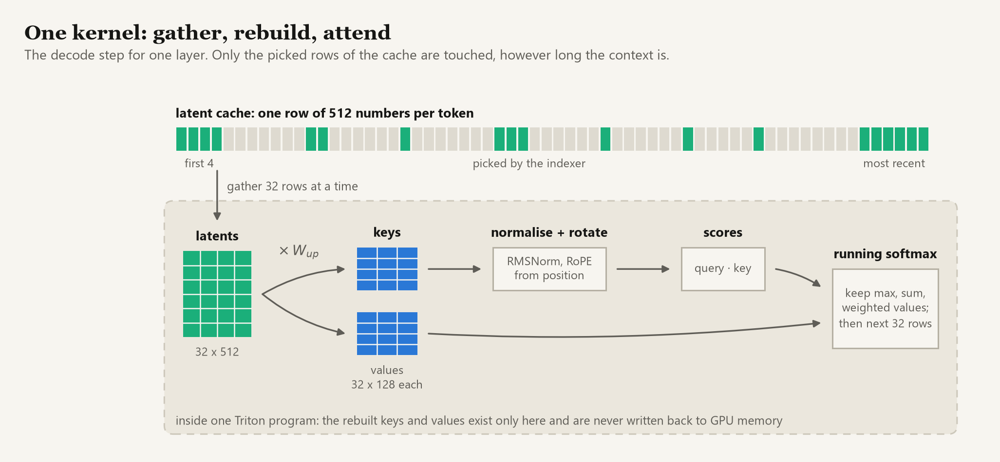
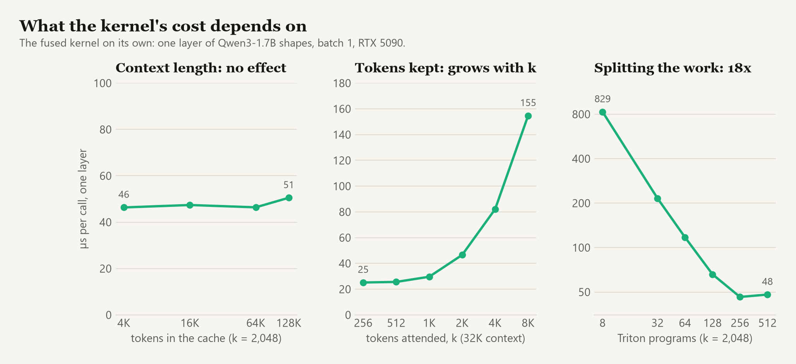
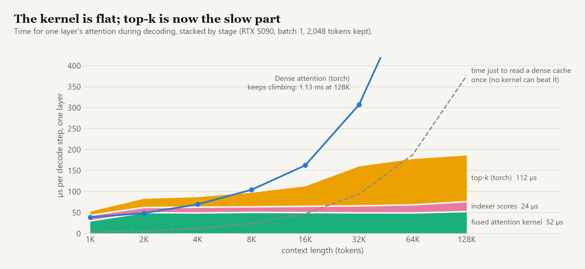

This is the kernel behind [sparse latent attention](/portfolio/sparse_latent_attention/), where a Qwen3-1.7B caches a 512-number latent per token instead of keys and values, and each layer attends to only 2,048 tokens chosen by a small indexer. That post covers the idea and the results. This one is about the part that makes it fast: a single Triton kernel that gathers the chosen latents, rebuilds their keys and values, and attends over them, in about 50 µs per layer at any context length.

[The kernel is about 150 lines in `kernels.py`](https://github.com/OliverGrainge/Sparse-Latent-Attention/blob/master/src/sla/kernels.py)

## The problem

A latent cache is cheap to store and expensive to use. Before a layer can attend, each latent has to be turned back into a key and a value:

$$
[\,k_s;\ v_s\,] = W_{\text{up}}\, c_s, \qquad k_s \leftarrow \operatorname{RoPE}\!\big(\operatorname{RMSNorm}(k_s),\ s\big)
$$

DeepSeek's design avoids this by folding the up-projection into the query. Qwen3 normalises and rotates its keys after the projection, and neither step is linear in the latent, so there is nothing to fold. The rebuild has to happen on every decode step, in every layer.

Sparse attention makes that affordable, because only the 2,048 chosen tokens need rebuilding. What is left is doing it without wasting the saving.

## Starting point

I started with the obvious PyTorch version: gather the 2,048 latents, multiply by the up-projection, normalise, rotate, attend. It is correct, and it is what the tests compare against. With token selection included it takes about 340 µs per layer.

Every one of those steps is its own GPU kernel, and each writes its result to memory for the next to read back. The rebuilt keys and values are 2,048 × 2,048 numbers that exist only to be consumed immediately. The goal for the Triton version was one kernel in which they never leave the chip:

{: .wide}

## The design

**Splitting the work.** There is only one query, so there is nothing to parallelise over on the query side. Instead the *keys* are split, as in flash-decoding. Each program handles one of the 8 key/value heads and a slice of the chosen tokens. 2,048 tokens in blocks of 32 is 64 blocks; each program takes two, which makes 8 × 32 = 256 programs.

**Rebuilding a block.** The inner loop walks the 512 latent dimensions in chunks of 64 and accumulates three small matrix products: one for each half of the keys, one for the values. A program reads only its own head's columns of the up-projection, an eighth of the matrix.

```python
# simplified from kernels.py
for r0 in range(0, R, BLOCK_R):                 # R = 512, BLOCK_R = 64
    c = tl.load(c_ptr + pos[:, None] * stride_cs + (r0 + offs_r)[None, :])   # 32 x 64 latents
    k_lo = tl.dot(c, w_klo, k_lo)               # first half of the key dims
    k_hi = tl.dot(c, w_khi, k_hi)               # second half
    v    = tl.dot(c, w_v, v)
```

**Normalising and rotating.** The keys come out in two halves on purpose. Qwen3's RoPE pairs dimension *i* with dimension *i* + 64, so with the halves already separate the rotation is plain elementwise arithmetic. The angle depends only on the token's position, and that position is the same index used to gather the latent, so there is no table of sines and cosines to read.

```python
rs    = tl.rsqrt((tl.sum(k_lo * k_lo, 1) + tl.sum(k_hi * k_hi, 1)) / D + eps)   # RMSNorm
k_lo, k_hi = k_lo * rs[:, None] * knw_lo, k_hi * rs[:, None] * knw_hi
ang   = pos.to(tl.float32)[:, None] * inv_freq[None, :]
kr_lo = k_lo * tl.cos(ang) - k_hi * tl.sin(ang)
kr_hi = k_hi * tl.cos(ang) + k_lo * tl.sin(ang)
```

**Attending.** Two query heads share each key/value head, so a rebuilt block is scored against both at once. The block is then folded into a running softmax: keep the largest score so far, the sum of exponentials relative to it, and the weighted sum of values, and rescale all three when a new maximum appears.

```python
s     = (tl.dot(q_lo, tl.trans(kr_lo)) + tl.dot(q_hi, tl.trans(kr_hi))) * scale
m_new = tl.maximum(m, tl.max(s, axis=1))
alpha = tl.exp(m - m_new)
p     = tl.exp(s - m_new[:, None])
l     = l * alpha + tl.sum(p, axis=1)
acc   = acc * alpha[:, None] + tl.dot(p, v)
m     = m_new
```

**Combining.** When a program finishes it writes out only those three things. A tiny second kernel merges the 32 partial results per head into the final output.

## Two things that bit me

**`tl.dot` wants at least 16 rows.** There are only 2 query heads per group, and the indexer has 8 heads, so both are padded to 16 with zeros and masked out again.

**Top-k does not forgive rounding.** My first end-to-end test used an untrained indexer in bf16, where many scores tie or swap order between the prompt pass and the decode pass. Top-k is discontinuous, so a different pick in an early layer changes the input of the next, and by the last layer the decoded tokens agreed with the reference only 12% of the time. The kernel was fine; the test was not. I moved the scores to fp32 to remove the ties and split the test in two: selection in fp32, where cached decoding must match a full forward pass exactly, and the kernel in bf16 with every token kept, where it must match within rounding.

## Profile

{: .wide}

- **Context length does nothing.** 46 µs at 4K tokens, 51 µs at 128K. The kernel touches the cache only at the chosen positions.
- **Cost follows the number of tokens kept.** About 18 µs per thousand tokens, on top of a floor of about 25 µs at small k.
- **The split is the single biggest factor.** With one program per head (8 in total) the same work takes 829 µs. With 256 programs it takes 46 µs, 18× faster. Going to 512 does not help.
- **Block size barely matters.** Rebuilding 16 tokens at a time takes 60 µs; 32 and 64 both take 47 µs.

Put back into the full decode step, alongside the indexer and the selection:

{: .wide}

The whole step is 190 µs per layer at 128K, against 340 µs for the PyTorch version and 1.13 ms for dense attention. The fused kernel is now the smaller part of it. More than half is `torch.topk`.

## What is next

- **A top-k kernel.** Selection is the bottleneck now, and it is the only stage whose cost still grows with context.
- **Prompt processing.** This kernel handles one query at a time. Processing a long prompt still uses a slow reference path.
- **Batches.** Everything here is measured at batch size 1.
