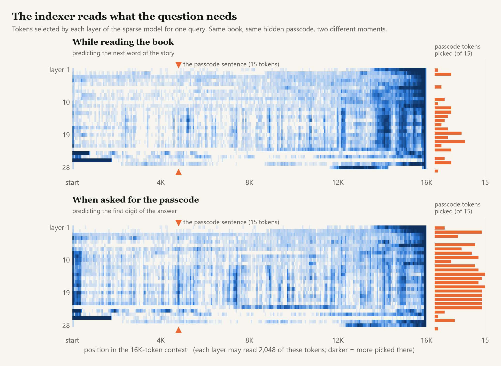
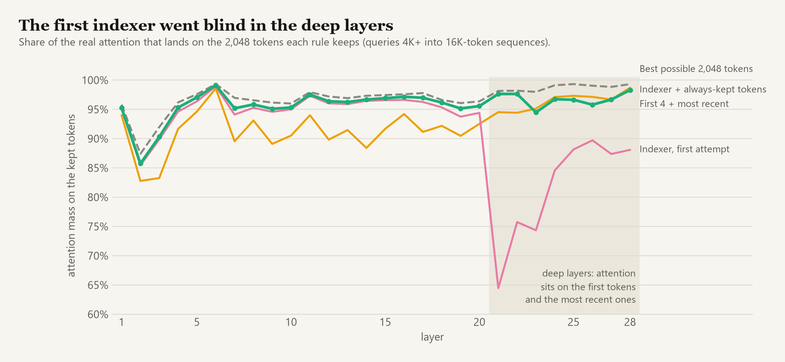
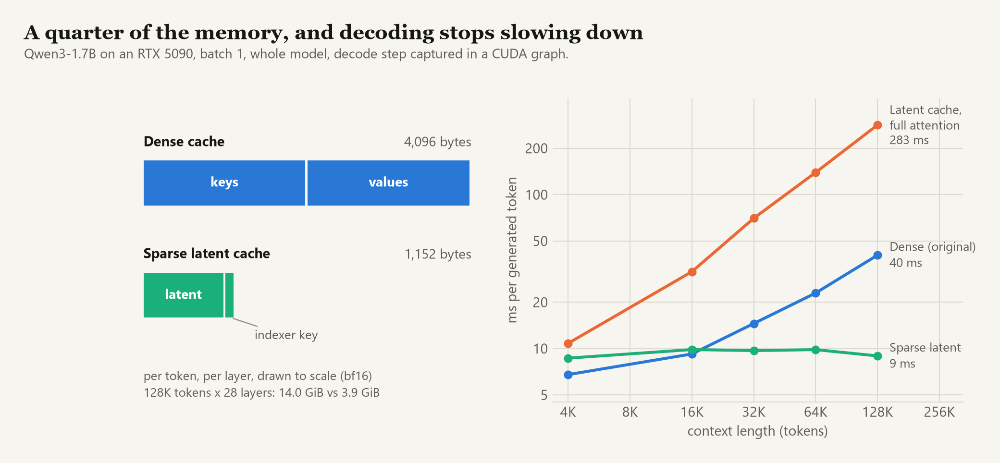
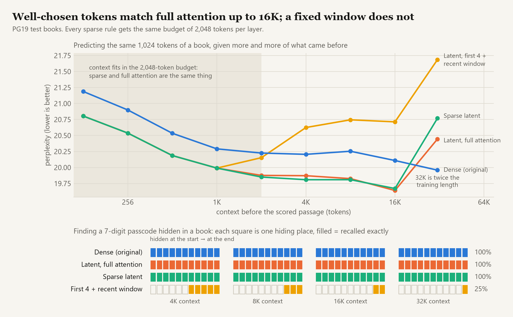
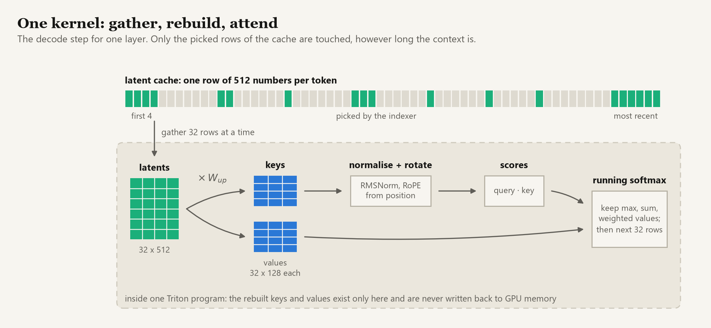
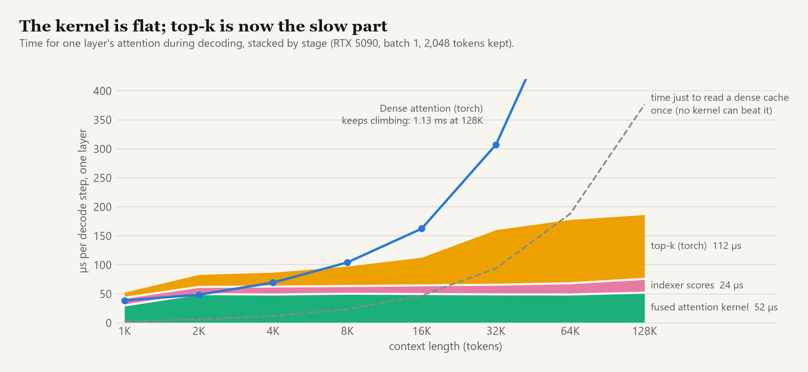

Every token a language model generates has to read the key/value cache of every layer, all of it. At long context that read is most of the work. I wanted to see how far two ideas from DeepSeek would go on a small model I could train at home: cache something smaller than keys and values, and read only the part of the cache that matters.

So I took a pretrained Qwen3-1.7B, rewrote it in plain PyTorch, and bolted both ideas on. This is what the result does when it reads a 16K-token book with a passcode hidden in it:

{: .wide}

Each row is a layer, and each layer may read only 2,048 of the 16,384 tokens. While the model is reading the story, the passcode sentence is mostly ignored: no layer picks more than 9 of its 15 tokens. Ask for the passcode, and 14 of the 28 layers pick at least 12 of them. Nothing told the model where the sentence was. A small learned scorer found it.

[View the code on GitHub](https://github.com/OliverGrainge/Sparse-Latent-Attention)

## The idea

**Store less.** Qwen3 caches 2,048 numbers per token per layer (keys and values for 8 heads of 128 dimensions). I replace them with one 512-number latent and rebuild keys and values from it on demand:

$$
c_s = W_{\text{down}}\, x_s \in \mathbb{R}^{512}, \qquad
[\,k_s;\ v_s\,] = W_{\text{up}}\, c_s
$$

The original weights stay frozen. Only the two projections are trained, by distilling the original model's predictions.

**Read less.** A tiny *indexer* in each layer gives every earlier token *s* a score for the current token *t*, and attention then looks only at the 2,048 best:

$$
I(t, s) = \sum_{j=1}^{8} w_{t,j}\, \operatorname{ReLU}\!\left(q_{t,j} \cdot k^{I}_{s}\right)
$$

Its keys are 64 numbers per token. Each indexer is trained to imitate its own layer's real attention, so nothing backpropagates through the model and the whole lot trains in 25 minutes.

**Why they need each other.** DeepSeek's latent attention folds the up-projection into the query, so keys are never rebuilt. Qwen3 normalises and rotates its keys *after* projecting them, which blocks that trick: I have to rebuild them every step. Over a whole cache, that is 7× *slower* than not compressing at all. Rebuilding only 2,048 tokens costs the same at any context length.

## What went wrong

Three things did not work the first time.

**Compressing without training.** Initialising the projections with PCA and stopping there took WikiText perplexity from 15.7 to over 1,000. Each layer was only slightly off; 28 slightly-off layers were not. Thirty steps of distillation brought it back to 16.9. Later I found that a model distilled on 4K-token sequences fell apart past 8K, and had to distil again at 16K.

**The first indexer lost to a rule with no parameters.** Averaged over layers it kept 91% of the attention mass. Keeping the first 4 tokens plus the most recent ones kept 93%.

{: .wide}

The per-layer view shows why. In the last eight layers almost all attention sits on the very first tokens and the last few dozen, and my indexer was missing the recent ones. The fix was to stop asking it to learn that: always keep the first 4 and the last 128 tokens, and train the indexer only on the rest. That reaches 95.8%, where the best possible choice of 2,048 tokens reaches 97.0%.

**The first benchmark showed almost no speed-up.** The kernel was fast, but the whole model was not, because Python and kernel-launch overhead swamped it. Capturing the decode step in a CUDA graph removed that. Along the way I found PyTorch's matmul runs about 4× slower when the cache length is not a multiple of 8, so dense decoding took either 43 or 115 ms per token at 128K depending on where I stopped. The numbers below give dense its best case.

## Results

{: .wide}

The cache is 3.6× smaller at every length. Decoding stays at about 9 ms per token from 4K to 128K, while the original model slows from 7 to 40 ms. Below 16K the original is still faster; the indexer and the rebuild are a fixed cost that only pays off once the context is long.

{: .wide}

Up to 16K, the sparse model is within 0.06 perplexity of the same latent model reading everything. A fixed window with the same budget gets worse as context grows, and finds the passcode only when it happens to be recent. Two honest caveats. The latent models score slightly *better* than the original at short context; that is distillation changing calibration, not a better model. And both get worse at 32K, twice the length they were trained on.

## The kernel

The expensive step is rebuilding keys and values, so I fused it into the attention kernel:

{: .wide}

Each decode step, per layer:

```
scores = indexer(q, all indexer keys)      # Triton, 128 bytes per token
idx    = topk(scores, 2048)                # torch, first and recent tokens forced in
out    = sparse_latent_attention(q, cache, W_up, idx)   # Triton, the diagram above
```

Inside the last kernel, each block of 32 latents is gathered, multiplied by the up-projection, normalised, rotated by its own position, scored against the query and folded into a running softmax. The rebuilt keys and values live only inside the kernel.

{: .wide}

The fused kernel takes about 50 µs per layer whether the context is 2K or 128K. What grows now is `torch.topk`, which is more than half the step at 128K. That is the next thing to write.

**[How the kernel was built, and its profile →](/portfolio/sparse_attention_kernel/)**

## Summary

- A latent cache and sparse attention fit together: one cuts what is stored (3.6×), the other cuts what is read (2,048 tokens), and sparsity is what makes a latent cache affordable on a model that cannot absorb it.
- On Qwen3-1.7B at 128K context, decoding is 4.5× faster with no measurable quality loss up to the training length. Below 16K it is not a win.
- It cost about 3.5 hours of training on one RTX 5090, with the original weights frozen and 2% more parameters.
- Still missing: a sparse kernel for prompt processing, a top-k kernel, training beyond 16K, and batching.
